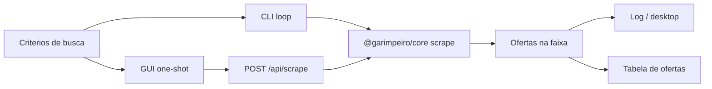

# Heimdall

<p align="center">
  
</p>

<p align="center">


</p>

**Vigiando a OLX para você pegar o preço certo.**

Heimdall monitora anúncios na OLX dentro de uma faixa de preço: scrape local, matching por banda percentual, loop + notificações no CLI, e uma GUI SaaS via API Fastify. Ferramenta interna sob `personal-tools/` (pacotes npm ainda usam o escopo `@garimpeiro/*`).

**Referência rápida:** [docs/cli/README.md](docs/cli/README.md)

## Table of Contents

- [Features](#features)
- [Installation](#installation)
- [Recommended workflow](#recommended-workflow)
- [CLI reference](#cli-reference)
- [Interface web + API](#interface-web--api)
- [How it works](#how-it-works)
- [File structure](#file-structure)
- [Limitations](#limitations)
- [Safety and operations](#safety-and-operations)
- [License](#license)

## Features

- **Busca OLX:** monta URLs por UF, DDD/região, zona, cidade, produto, ordem e páginas.
- **Faixa de preço:** filtra anúncios em torno do preço alvo (`percentual`).
- **CLI (`@garimpeiro/cli`):** loop periódico, notificações via log e desktop (`node-notifier`).
- **API (`@garimpeiro/api`):** `POST /api/scrape` e `GET /api/health` (Fastify).
- **GUI (`apps/gui`):** shell SaaS (dashboard, nova busca, ofertas, buscas salvas, histórico) — workspace em `localStorage`.
- **Core (`@garimpeiro/core`):** scrape, parsing de input, matching; entry browser-safe em `@garimpeiro/core/browser`.

## Installation

### Prerequisites

- [Node.js](https://nodejs.org/) **22+**
- No Linux, para notificações desktop do CLI: `notify-osd` ou `libnotify-bin` ([detalhes](https://github.com/mikaelbr/node-notifier#requirements))
- Para API + GUI via Docker: Docker Engine e Docker Compose

### Steps

```sh
cd caminho-do-repo
npm install
npm run build
```

O build da raiz ordena **core → cli → api**. A GUI: `npm run build -w gui` ou `make build`.

## Recommended workflow



1. **CLI contínuo** — monitore e receba alertas:

   ```sh
   npm start -- --uf sp --ddd 12 --produto apartamento --preco 300000
   # ou
   make cli-dev -- --uf sp --ddd 12 --produto apartamento --preco 300000
   ```

2. **GUI + API** — uma execução por vez, com histórico local:

   ```sh
   make dev   # http://localhost:5173
   ```

## CLI reference

Entry: `npm start -- [opções]` ou `node apps/cli/dist/main.js`.

Ajuda:

```sh
npm start -- --help
make cli-dev -- --help
```

Documentação por grupo de opções: [docs/cli/README.md](docs/cli/README.md).

Exemplo:

```sh
npm start -- --uf sp --ddd 12 --zona 'vale do paraiba' --cidade 'sao jose dos campos' --produto apartamento --preco 1
```

URL equivalente:

<https://www.olx.com.br/estado-sp/vale-do-paraiba-e-litoral-norte/vale-do-paraiba/sao-jose-dos-campos?q=apartamento>

Dev com recarga:

```sh
npm run dev -- --uf sp --ddd 12 --produto apartamento --preco 300000
```

## Interface web + API

### Docker (recomendado)

```sh
make dev   # API + Vite (http://localhost:5173)
make up    # produção (GUI em http://localhost:8080)
make down
```

### Host

```sh
npm run dev:gui
```

Detalhes: [apps/gui/README.md](apps/gui/README.md).

| Variável | Onde | Padrão |
|----------|------|--------|
| `GARIMPEIRO_GUI_ORIGIN` | API | `http://localhost:5173` |
| `VITE_API_PROXY_TARGET` | Vite | `http://localhost:3000` |
| `PORT` / `HOST` | API | `3000` / `0.0.0.0` |

## How it works

1. **Critérios** — UF, DDD → região OLX, zona/cidade (kebab-case), produto, preço, percentual, ordem, páginas (`parseScrapeInput` no core).
2. **Fetch** — páginas de busca via `got-scraping` + JSDOM.
3. **Match** — anúncios na faixa `[preço × (1 − %/100), preço × (1 + %/100)]`.
4. **CLI** — `notifyMatches` (log / desktop) e loop por `intervalo`.
5. **GUI** — `POST /api/scrape`; KPIs e histórico ficam no navegador (`localStorage`).

Apps **não** importam uns aos outros. Sempre build do core primeiro. Imports internos usam `@/`.

## File structure

```text
garimpeiro-olx/
├── README.md
├── package.json          # workspaces + scripts raiz
├── Makefile
├── docker-compose.yml
├── docker-compose.dev.yml
├── public/
│   └── heimdall_icon.png
├── docs/cli/
├── packages/core/        # @garimpeiro/core
└── apps/
    ├── cli/              # @garimpeiro/cli
    ├── api/              # @garimpeiro/api
    └── gui/              # SPA Vite + React
```

## Limitations

- HTML/DOM da OLX pode mudar e quebrar o extrator.
- Respostas 403 / anti-bot dependem do cliente HTTP atual.
- GUI: sem conta; buscas/histórico só neste navegador.
- Notificações desktop são responsabilidade do CLI no host, não da GUI.

## Safety and operations

- Uso pessoal / interno; respeite os termos da OLX e evite carga agressiva (`paginas`, intervalo do loop).
- Não versionar segredos (não há `.env` obrigatório para o fluxo padrão).
- Licença copyleft: alterações distribuídas devem permanecer AGPL.

## License

[AGPL 3.0 ou superior](https://github.com/mrocha98/garimpeiro-olx/blob/main/LICENSE).

Sugestões e PRs: [issues](https://github.com/mrocha98/garimpeiro-olx/issues).
